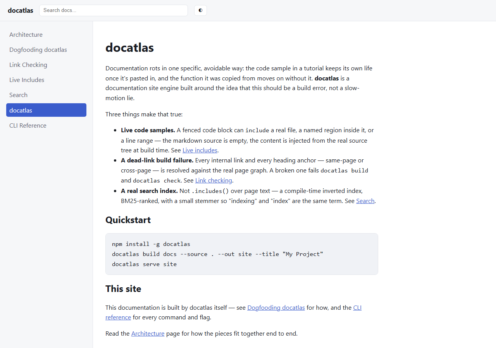
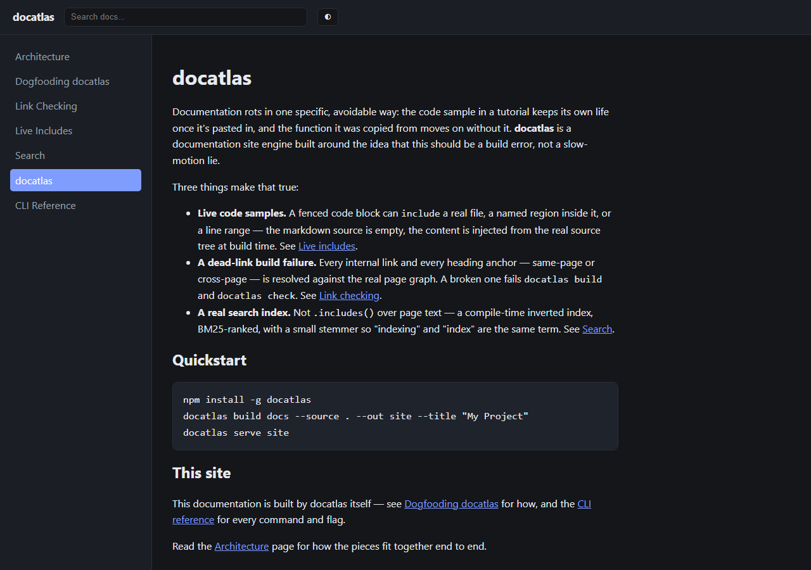
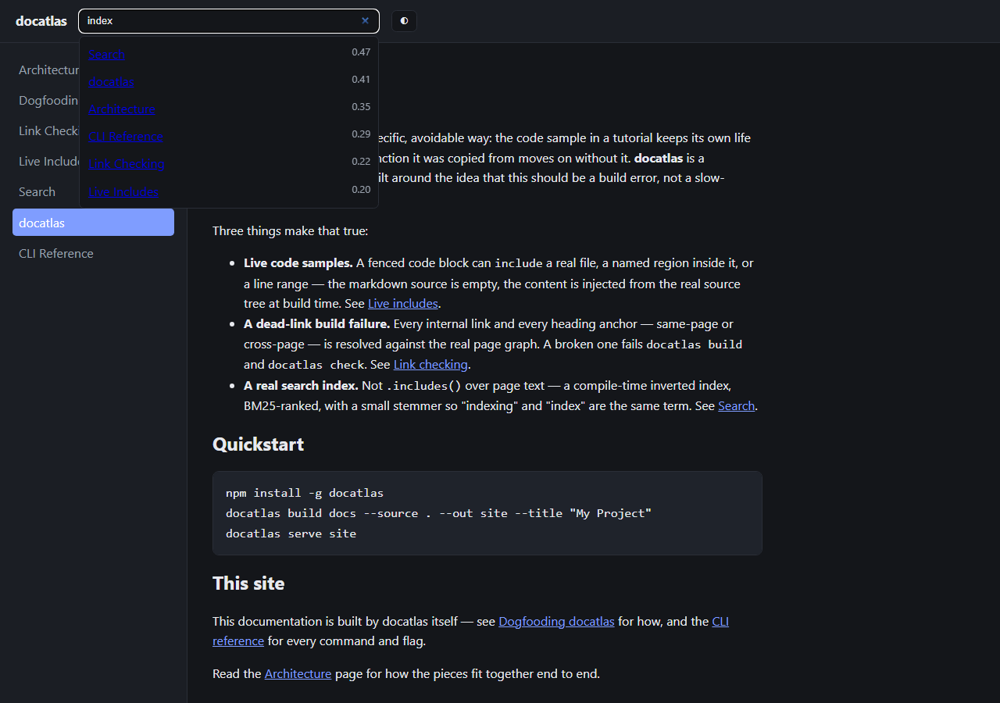

# docatlas

**A documentation site engine whose cross-references cannot go stale.**

Code samples are pulled live from the real source tree at build time — not
hand-copied and quietly forgotten. Every internal link and heading anchor is
resolved against the real page graph, and a dead one fails the build. Search
is a real inverted index, BM25-ranked, built at compile time — not
`.includes()` over page text.

This documentation site is itself built with docatlas, and CI fails the
build if it ever drifts from that claim. See
[`docs/guide/dogfooding.md`](./docs/guide/dogfooding.md).

<p align="center">
  
  
</p>

<p align="center">
  
</p>

## Why

Every documentation site eventually accumulates code samples that were
correct the day they were pasted in and have quietly diverged from the
codebase ever since — and links that pointed somewhere real until a page got
renamed. Most tooling treats both as a proofreading problem. docatlas treats
them as a **build** problem:

- **Live includes.** A fenced code block can `include="file.ts"`,
  `include="file.ts#region-name"` (a `docatlas:start:NAME` /
  `docatlas:end:NAME` marker pair, matched regardless of comment syntax), or
  `include="file.ts:12-30"` (a line range). The markdown source is empty —
  the content is injected from the real file at build time, so it cannot
  drift from what the file actually says.
- **A dead-link build failure.** Every relative link and every same-page or
  cross-page heading anchor is resolved against the real, fully-parsed page
  graph. Broken by default fails `docatlas build` and `docatlas check`, and
  the links written into the generated HTML are rewritten to the `.html`
  files that actually exist (a test crawls the built site, including this
  project's own docs, and fails on any relative link that does not resolve).
- **A real search index.** Not client-side substring matching — a compile-time
  inverted index (tokenized, lightly stemmed, term → posting list) ranked
  with Okapi BM25, shipped as a static JSON asset and queried by the exact
  same ranking module both in the browser and from `docatlas search` on the
  command line.

## Quickstart

docatlas is not published to npm yet; build it from a clone and link the
`docatlas` command:

```sh
git clone https://github.com/hellpuffyt/docatlas.git
cd docatlas
npm install
npm run build
npm link            # puts `docatlas` on your PATH (or run `node dist/cli.js`)

docatlas build docs --source . --out site --title "My Project"
docatlas serve site
# -> http://127.0.0.1:4173
```

Or validate a docs tree without writing a persistent output directory —
the form CI should use:

```sh
docatlas check docs --source .
```

## A live include, for real

This is not a mockup — the block below is generated by docatlas from
[`src/snippets/extractor.ts`](./src/snippets/extractor.ts) at build time,
using `include="src/snippets/extractor.ts#extract-region"` in
[`docs/guide/live-includes.md`](./docs/guide/live-includes.md). If this
function's signature ever changes, this README's copy (kept in sync by hand,
since GitHub doesn't run docatlas over its own markdown) and the generated
docs page both need updating — but the generated docs page updates itself:

```ts
export function extractRegion(fileContent: string, regionName: string): string {
  const lines = fileContent.split("\n");
  const startRe = startMarker(regionName);
  const endRe = endMarker(regionName);

  const startIdx = lines.findIndex((l) => startRe.test(l));
  if (startIdx === -1) {
    throw new SnippetExtractionError(`no "docatlas:start:${regionName}" marker found`);
  }
  const endIdx = lines.findIndex((l, idx) => idx > startIdx && endRe.test(l));
  if (endIdx === -1) {
    throw new SnippetExtractionError(`no "docatlas:end:${regionName}" marker found`);
  }

  const body = lines.slice(startIdx + 1, endIdx);
  return dedent(body).join("\n");
}
```

## Architecture

```
markdown files
      │
      ▼
 parseMarkdown ──► ParsedDocument (front matter + Block[])
      │
      ▼
resolveSnippets ──► live "include=" fences resolved against --source,
      │              or a SnippetError per unresolved one
      ▼
   Page[] ──► headingSlugs, outgoingLinks, plainText per page
      │
      ├──► checkLinks ──► LinkError[] (dead links / dead anchors)
      │
      ├──► buildIndex ──► inverted index, BM25-ranked at query time
      │
      └──► renderBlocks + renderPage ──► static HTML per page
```

Full module map in [`docs/architecture.md`](./docs/architecture.md) (built
with docatlas, naturally).

## CLI

| Command | What it does |
|---|---|
| `docatlas build <docsDir> --source <dir> --out <dir>` | Full build: parse, resolve includes, check links, write HTML + search index. Fails on any error unless `--allow-broken-links`. |
| `docatlas check <docsDir> --source <dir>` | Same validation as `build`, no persistent output directory — the form CI uses. |
| `docatlas serve <outDir> [--port <n>]` | Serves a built site over plain HTTP for local preview. |
| `docatlas search <indexJsonPath> <query>` | Ranked BM25 hits from the command line, no browser needed. |

Full flag reference: [`docs/reference/cli.md`](./docs/reference/cli.md).

## Project layout

```
src/
  markdown/    hand-written parser targeting documentation prose
  snippets/    live "include=" resolution (regions + line ranges)
  links/       dead-link / dead-anchor checker
  search/      shared tokenizer + stemmer, inverted index, BM25 ranking
  site/        HTML rendering, page template (dark/light, nav, search UI), build orchestration
  cli.ts       build / check / serve / search subcommands
docs/          this project's own documentation, built by itself (see below)
test/          199 tests mirroring the src/ layout, ~97% statement coverage
```

## Development

```sh
npm install
npm run build       # compile src/ → dist/
npm run typecheck    # tsc --noEmit
npm run lint          # eslint, zero warnings
npm test                # vitest run — 199 tests
npm run coverage      # vitest run --coverage
```

CI runs all of the above on Linux, Windows and macOS, plus a dogfood job
that builds and checks this project's own `docs/` with the `docatlas`
binary it just compiled. See [`CONTRIBUTING.md`](./CONTRIBUTING.md).

## License

[MIT](./LICENSE) © 2026 Prabesh Sharma
