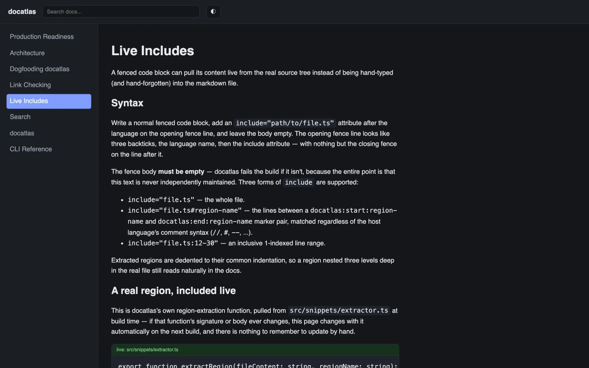
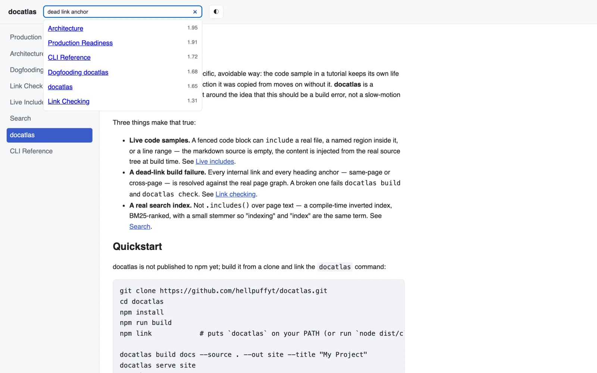

# docatlas

A static documentation site generator for markdown docs that live next to
code. Code blocks can include a file, a marked region or a line range from
the source tree at build time. Every relative link and heading anchor is
checked against the parsed pages, and a broken one fails the build. Search
uses a BM25-ranked inverted index that is built at compile time and shipped
as JSON.

This repository's own `docs/` is built with docatlas, and CI fails if that
build or its link check fails. See
[`docs/guide/dogfooding.md`](./docs/guide/dogfooding.md).

[Case study ↗](https://hellpuff.dev/work/docatlas)



*Real screenshot: docatlas's own docs, built by docatlas, open on the Live
Includes guide in dark theme. The green "live: src/snippets/extractor.ts"
block is injected from the source file at build time.*



*Real screenshot: the built-in search box returning BM25-ranked pages, with
scores, for the query "dead link anchor".*

## Status

Version 0.1.0, not published to npm. Typecheck, lint, 201 tests and a
dogfood build of this repository's own `docs/` run in CI on every push.

## What it checks

Code samples pasted into docs drift from the code, and links break when a
page is renamed. docatlas makes both build errors:

- **Live includes.** A fenced code block with an empty body can use
  `include="file.ts"` (the whole file), `include="file.ts#region-name"` (the
  lines between a `docatlas:start:NAME` and `docatlas:end:NAME` marker, in any
  comment syntax) or `include="file.ts:12-30"` (a line range). The content is
  read from the file at build time. A missing file or region fails the build,
  and so does an include path outside `--source`.
- **Dead links and anchors.** Every relative link and every same-page or
  cross-page heading anchor is resolved against the parsed page graph.
  `docatlas build` and `docatlas check` fail on a broken one. Links in the
  generated HTML are rewritten to the `.html` files that exist, and a test
  crawls the built site (including this project's docs) for unresolved links.
- **Search.** The build writes an inverted index (tokenized, lightly stemmed,
  term to posting list) as a static JSON file. The same BM25 ranking module
  answers queries in the browser and from `docatlas search`.

## Requirements

- Node.js and npm. CI tests Node 20 (Linux, Windows, macOS) and Node 22
  (Linux). `package.json` declares `engines: >=18`, but Node 18 is not tested,
  and the dev toolchain (vitest 4) needs Node 20 or newer.
- No runtime dependencies, network access or services.

## Quickstart

docatlas is not published to npm yet; build it from a clone and link the
`docatlas` command:

```sh
git clone https://github.com/hellpuffyt/docatlas.git
cd docatlas
npm install
npm run build
npm link            # puts `docatlas` on your PATH (or run `node dist/cli.js`)

docatlas build docs --source . --out site --title "My Project"
# built 8 page(s) -> site
docatlas serve site
# docatlas serve: http://127.0.0.1:4173
```

To validate a docs tree without keeping an output directory (the form to use
in CI):

```sh
docatlas check docs --source .
# docatlas check passed: 8 page(s), 0 issues
```

Query the compiled index from the terminal:

```sh
docatlas search site/assets/search-index.json bm25
# 0.558  Search  (guide/search.html)
# 0.557  Dogfooding docatlas  (guide/dogfooding.html)
# ...
```

(The page counts and scores above are from building this repository's own
`docs/`; yours will differ.)

## Example: a live include

[`docs/guide/live-includes.md`](./docs/guide/live-includes.md) contains an
empty code block with `include="src/snippets/extractor.ts#extract-region"`.
docatlas fills it from
[`src/snippets/extractor.ts`](./src/snippets/extractor.ts) on every build.
GitHub does not run docatlas over this README, so the copy below is
maintained by hand. The generated docs page updates itself.

```ts
export function extractRegion(fileContent: string, regionName: string): string {
  const lines = fileContent.split("\n");
  const startRe = startMarker(regionName);
  const endRe = endMarker(regionName);

  const startIdx = lines.findIndex((l) => startRe.test(l));
  if (startIdx === -1) {
    throw new SnippetExtractionError(`no "docatlas:start:${regionName}" marker found`);
  }
  const endIdx = lines.findIndex((l, idx) => idx > startIdx && endRe.test(l));
  if (endIdx === -1) {
    throw new SnippetExtractionError(`no "docatlas:end:${regionName}" marker found`);
  }

  const body = lines.slice(startIdx + 1, endIdx);
  return dedent(body).join("\n");
}
```

## Architecture

```
markdown files
      │
      ▼
 parseMarkdown ──► ParsedDocument (front matter + Block[])
      │
      ▼
resolveSnippets ──► live "include=" fences resolved against --source,
      │              or a SnippetError per unresolved one
      ▼
   Page[] ──► headingSlugs, outgoingLinks, plainText per page
      │
      ├──► checkLinks ──► LinkError[] (dead links / dead anchors)
      │
      ├──► buildIndex ──► inverted index, BM25-ranked at query time
      │
      └──► renderBlocks + renderPage ──► static HTML per page
```

The full module map is in [`docs/architecture.md`](./docs/architecture.md).

## CLI

| Command | What it does |
|---|---|
| `docatlas build <docsDir> --source <dir> --out <dir>` | Full build: parse, resolve includes, check links, write HTML + search index. Fails on any error unless `--allow-broken-links`. |
| `docatlas check <docsDir> --source <dir>` | Same validation as `build` without a persistent output directory. Use this in CI. |
| `docatlas serve <outDir> [--port <n>]` | Serves a built site over plain HTTP for local preview. |
| `docatlas search <indexJsonPath> <query> [--top <n>]` | Ranked BM25 hits from the command line (default top 10), no browser needed. |
| `docatlas --version` / `--help` | Print the version or usage. |

Full flag reference: [`docs/reference/cli.md`](./docs/reference/cli.md).

## Project layout

```
src/
  markdown/    hand-written parser targeting documentation prose
  snippets/    live "include=" resolution (regions + line ranges)
  links/       dead-link / dead-anchor checker
  search/      shared tokenizer + stemmer, inverted index, BM25 ranking
  site/        HTML rendering, page template (dark/light, nav, search UI), build orchestration
  cli.ts       build / check / serve / search subcommands
docs/          this project's own documentation, built by docatlas
test/          201 tests mirroring the src/ layout, ~97% statement coverage
```

## Development

```sh
npm install
npm run build       # compile src/ → dist/
npm run typecheck    # tsc --noEmit
npm run lint          # eslint, zero warnings
npm test                # vitest run (201 tests)
npm run coverage      # vitest run --coverage
```

CI runs all of the above on Linux, Windows and macOS, plus a dogfood job
that builds and checks this project's own `docs/` with the `docatlas`
binary it just compiled. See [`CONTRIBUTING.md`](./CONTRIBUTING.md).

## Limitations

- Not on npm yet; build from a clone (see Quickstart).
- `docatlas serve` is a local preview server bound to `127.0.0.1`. Publish
  the built static files with a real web server.
- The page template has a single breakpoint: below 48rem the sidebar stacks
  above the content as a wrapped link list. There is no collapsible menu.
- `--top` for `search` works but is not listed in `docatlas --help` (it is in
  the [CLI reference](./docs/reference/cli.md)).
- The markdown parser is hand-written for documentation prose, not a full
  CommonMark implementation.

## Security

See [`SECURITY.md`](./SECURITY.md) for scope and how to report a
vulnerability privately.

## License

[MIT](./LICENSE) © 2026 Prabesh Sharma
